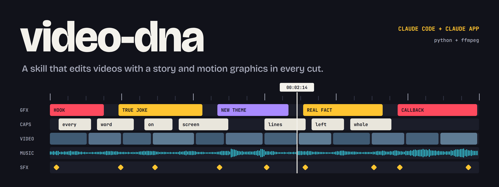
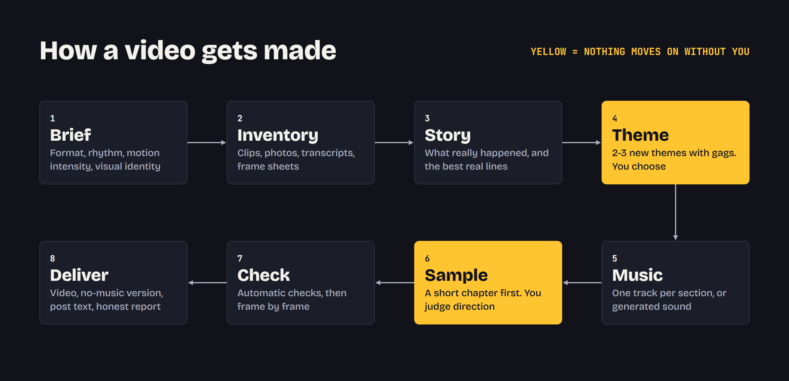

A skill for Claude that turns a folder of footage, or just a brief, into a finished video. Every video gets its own theme drawn from what really happened, and every graphic carries a true joke or a true fact. The method comes from real editing sessions on vlogs, event promos, team updates and aftermovies.

## What it does

- **Asks first.** Format, orientation, length, rhythm, motion graphics intensity, visual identity and audio. It skips anything you already said, and offers defaults.
- **Finds the story.** Transcribes speech, reviews your clips on frame sheets, and picks out the best real moments.
- **Proposes 2-3 new themes** with concrete gags, then waits for your choice.
- **Edits with intent.** A hook in the first seconds, cuts on the beat, callbacks, word-by-word captions, and a sound for each graphic.
- **Renders and checks.** Audio and video stay equal in length, text is checked for size and position, QR codes are decoded from rendered frames.
- **Delivers everything you need to post.** The video, a no-music version, and text for the post, for groups and for private messages. In Claude Code the files go straight into your folder. In the Claude app they arrive in the chat.



## Starting with an empty folder

You don't need footage. From code alone, the skill can make animated text, shapes, charts, maps, simple illustrations, sound effects and simple original chiptune-style music.

It cannot make realistic video or photos from code. It tells you so, then lists exactly what would help most so you can add it or continue without it. If image or video generation tools are connected to Claude, it offers them and asks first.

## Install

### Claude Code

```bash
git clone https://github.com/AGHEORONO/video-dna.git
cp -r video-dna/video-dna ~/.claude/skills/video-dna
```

Then install the requirements:

- [ffmpeg](https://ffmpeg.org/) built with libass
- `python ~/.claude/skills/video-dna/scripts/setup_tools.py --profile core`
- `python ~/.claude/skills/video-dna/scripts/setup_tools.py --profile transcribe`

## Tools

The core needs only ffmpeg and numpy. `setup_tools.py --list` shows the rest, and `--profile all` installs everything.

| Profile | Tools | Used for |
|---|---|---|
| `core` | numpy, OpenCV, Pillow | Mixing, sound effects, frame sheets, QR checks, faces |
| `transcribe` | faster-whisper | Whisper transcription |
| `whisper-alt` | openai-whisper | Original Whisper; whisper.cpp and the OpenAI API also work |
| `vision` | PySceneDetect, rembg | Finding cuts, cutting out people and objects |
| `graphics` | qrcode, fontTools, Playwright, OpenTimelineIO | QR codes, font checks, HTML scenes, export to other editors |
| `audio` | librosa, pyloudnorm, Demucs, Piper | Beats, loudness, voice and music separation, voiceover |

### Claude app

1. Download `video-dna.zip` from the [latest release](https://github.com/AGHEORONO/video-dna/releases/latest).
2. In Claude, open **Settings**, find the **Skills** section under capabilities, and upload the zip. Code execution must be turned on.

The menu names can change between versions of the app.

## Use it

Ask in plain words, in English or Romanian:

> Make a reel from the clips in this folder.

> Fă un aftermovie de 2 minute din folderul ăsta, cu mult motion graphics.

> Make an animated poster for our event. I have no footage, just these details.

Run `python scripts/doctor.py` from the skill folder to see what your environment supports.

## Claude Code and the Claude app

| | Claude Code | Claude app |
|---|---|---|
| Runs on | Your computer | A cloud sandbox |
| Your files | Direct access | Uploaded or from a connected folder |
| Finished videos | Written directly to your folder | Delivered directly in the chat |
| Internet | Yours | May be restricted |
| Big files | No limit from the skill | Transfers to your computer may be limited; it can compress or split |
| Transcription | Downloads the Whisper model on first use | Works if the model can be reached; otherwise you upload a transcript made on your computer |

## Limits

- **Claude can't hear the result.** It checks frames, durations and levels. Beat sync, caption timing and the mix are for you to judge, and the skill says so each time.
- **Music is yours to supply.** It does not download commercial music. Platforms may mute videos that contain it, so it can also give you a version to use with the platform's own music sticker.
- **Facts must be real.** Anything deduced or illustrative is listed for you to confirm.
- **Editing taste needs you.** Start with the short sample and give feedback.

## Tests

```bash
python tests/test_pipeline.py
```

This builds a video from generated test media and checks rendering, captions, sound, beat detection, QR decoding and file-size tools. It needs ffmpeg, numpy and opencv-python. Transcription is not part of this test, because it needs a model download.

`python tests/test_tools.py` tests the optional tools and skips any that aren't installed.

## License

[MIT](LICENSE)
